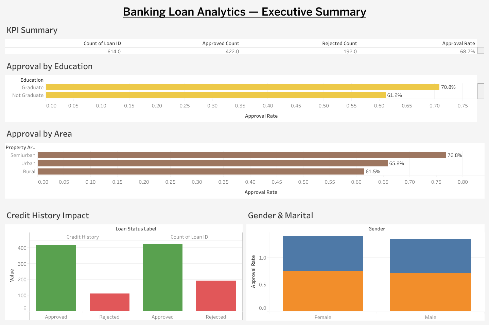
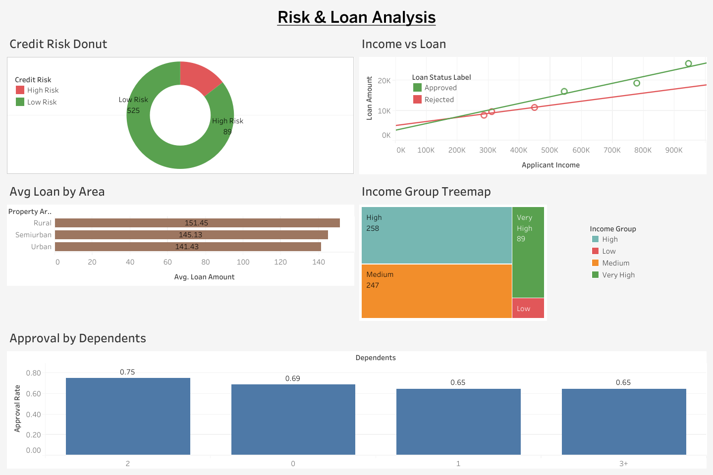
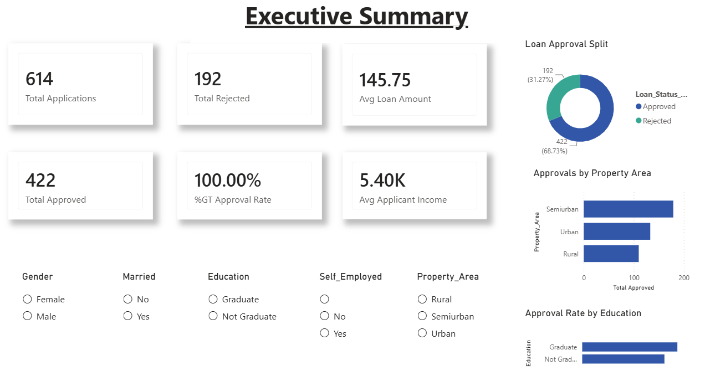

# Banking Customer Analytics & Loan Risk Dashboard

An end-to-end banking analytics project analyzing loan applications, approval patterns, customer segments, and credit risk using Google Sheet, Excel, Google BigQuery, PostgreSQL, Python, Power BI, Tableau.

The project combines data cleaning, exploratory data analysis, SQL-based business analysis, and interactive dashboards to generate insights into loan approval decisions and customer risk profiles.

## Dashboard Previews

### Tableau Public

Explore the interactive Tableau dashboards:

- [Executive Summary](https://public.tableau.com/app/profile/arun.pal4087/viz/BankingLoanAnalyticsDashboard/ExecutiveSummary)
- [Risk & Loan Analysis](https://public.tableau.com/app/profile/arun.pal4087/viz/Banking_Loan_Tableau_Dashboard/RiskLoanAnalysis)

**Executive Summary**



**Risk & Loan Analysis**



### Power BI

Existing five-page interactive dashboard developed using 12 DAX measures.



## Tech Stack

| Technology | Purpose |
|---|---|
| Google Sheets | Data cleaning, missing value treatment, derived columns, and data validation |
| Excel | Data cleaning, missing value treatment, pivot tables, and KPI analysis |
| Google BigQuery | Cloud data storage, SQL analysis, and creation of analytical views |
| PostgreSQL | 10 analytical SQL queries for business analysis |
| Python | Exploratory data analysis, correlation analysis, risk segmentation, and visualizations |
| Tableau | Two-page interactive dashboard containing 10 sheets |
| Power BI | Five-page interactive dashboard containing 12 DAX measures |

## Dataset

**Bank Loan Prediction Dataset (Kaggle)**

- 614 loan applications
- 13 original features
- Includes applicant demographics, income, loan details, credit history, property area, and loan approval status.

## Data Preparation

The project uses multiple tools to prepare and validate the banking dataset.

- **Excel:** Initial data cleaning, missing value treatment, and analysis.
- **Google Sheets:** Additional data cleaning, missing value treatment, derived columns, and validation.
- **BigQuery:** Storage of the cleaned Google Sheets dataset and creation of a readable analytical view.

The original dataset and existing cleaned dataset are retained separately.

The Google Sheets cleaned dataset export is available at:

`data/bank_loan_cleaned_google_sheets.csv`

## SQL Analysis

### PostgreSQL

Contains 10 analytical SQL queries addressing business questions related to loan approvals, credit history, income, and customer risk.

### Google BigQuery

The BigQuery implementation includes:

- Table schema definition.
- Cleaned dataset storage.
- Analytical view creation.
- 10 business-focused SQL queries.
- Risk segmentation using a Common Table Expression (CTE).
- Applicant income ranking using a window function.
- A loan summary view for downstream analysis.

**BigQuery Configuration**

- Project ID: `banking-analytics-514808`
- Dataset: `banking_analytics`

BigQuery SQL files are available in:

`sql/bigquery/`

## Key Business Insights

- Overall loan approval rate: 68.7%.
- Applicants with good credit history had an approval rate of 79.0%, compared with 7.9% for applicants with poor credit history.
- Semiurban properties had the highest approval rate at 76.8%.
- High-risk customers had a 0% approval rate in the analysis.
- Married applicants had a 71.8% approval rate, compared with 62.9% for single applicants.
- Rejected applicants requested higher average loan amounts (150) than approved applicants (144).

## Project Structure

```text
banking-analytics-dashboard/
│
├── data/
│   ├── Bank_Loan_Analytics.xlsx
│   ├── bank_loan.csv
│   ├── bank_loan_cleaned.csv
│   └── bank_loan_cleaned_google_sheets.csv
│
├── sql/
│   ├── queries.sql
│   └── bigquery/
│       ├── analysis_queries.sql
│       └── schema.sql
│
├── python/
│   ├── load_to_postgres.py
│   └── eda.py
│
├── outputs/
│   └── EDA charts
│
├── tableau/
│   └── Banking_Loan_Tableau_Dashboard.twb
│
├── Banking_Analytics_Dashboard.png
├── Banking_Loan_Dashboard.pbix
├── Executive_Summary.png
└── README.md
```

## How to Run

1. Download the Bank Loan Prediction dataset from Kaggle.
2. Open the raw dataset in Excel and perform data cleaning.
3. Load the dataset into PostgreSQL and execute the queries in `sql/queries.sql`.
4. Run the Python scripts to perform exploratory data analysis and generate visualizations.
5. Open the existing Tableau workbook in Tableau Desktop or explore the published Tableau Public dashboards.
6. Open the existing Power BI report in Power BI Desktop.
7. Review the additional data cleaning and validation performed in Google Sheets using the cleaned dataset export.
8. Access the BigQuery dataset and execute the SQL scripts in `sql/bigquery/`.

## Project Objectives

- Understand loan approval patterns and customer characteristics.
- Identify factors influencing loan approval decisions.
- Analyze the relationship between credit history, income, and loan status.
- Segment applicants based on financial and credit risk.
- Develop business-focused insights using SQL and Python.
- Build interactive dashboards to communicate analytical findings.
- Demonstrate data preparation and cloud analytics using Google Sheets and BigQuery.